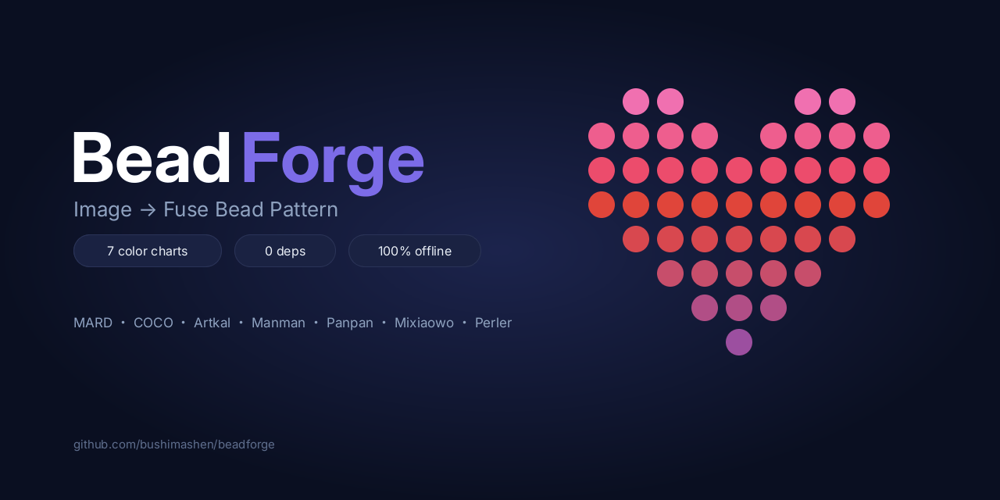

# BeadForge · 拼豆图纸生成器

[](LICENSE)
[]()
[]()

**一个单文件、零依赖、离线可用的拼豆图纸生成器。** 上传任意图片，自动按拼豆品牌标准色卡转换成像素图纸：带袋装色号、行列标尺、颜色清单，照着编码买豆就能拼。

<p align="center"></p>

---

## ✨ 功能

- **7 套品牌标准色卡**：MARD（291 色）、COCO（291 色）、优肯 Artkal（418 色）、漫漫家（278 色）、盼盼家（285 色）、咪小窝（286 色）、Perler（57 色，欧美标准）
- **智能取色**：redmean 加权色彩距离（比普通 RGB 欧氏距离更符合人眼观感）
- **Floyd–Steinberg 抖动**：照片 / 渐变图过渡更自然，也可关闭
- **亮度补偿**：拼豆成品常偏暗，照片建议 +10 ~ +30
- **限制颜色数**：6 / 12 / 24 / 36 档起可调，控制要买的豆色种类；超限时自动把用量最少的颜色并入邻近色
- **底板尺寸快捷键**：小底板 29 / 2×2 拼板 58 / 3×3 拼板 87
- **图纸导出**：
  - PNG（含色号）：格内印袋装编码，四周带 Excel 式行列标尺（每 10 格加深），下方附颜色清单，直接打印或存手机照着拼
  - PNG（纯图纸）：不含清单
  - CSV 颜色清单：带 BOM，Excel 双击打开不乱码
- **中英双语界面**（右上角切换）
- **透明背景处理**：透明区域自动留空不摆豆

## 🚀 快速开始

**方式一（推荐）**：下载 `index.html`，双击用浏览器打开。完事。

**方式二**：克隆仓库后双击打开（无需安装任何东西）：

```bash
git clone https://github.com/bushimashen/beadforge.git
```

**方式三**：部署成在线网页——把 `index.html` 放到任何静态托管上即可（GitHub Pages / Gitee Pages / 对象存储 / Nginx），也可以 `python -m http.server` 本地起服务。

> 支持 Chrome / Edge / Firefox / Safari 等现代浏览器，桌面与手机均可。

## 📖 使用说明

1. **导入图片**：点击上传区选择图片，或直接把图片拖进来，或 `Ctrl+V` 粘贴截图
2. **选色卡品牌**：默认 MARD（国内最主流，KK 家等兼容 MARD 色号的豆子可直接对上）；买哪个牌子的豆就选哪个
3. **调图纸宽度**：滑杆 10~150 豆宽；想做标准底板直接点 29 / 58 / 87 快捷键
4. **亮度补偿**：拼豆成品比屏幕显示偏暗，照片类建议 +10 ~ +30
5. **抖动**：像素画 / 色块图关闭；照片 / 渐变图开 Floyd–Steinberg
6. **限制颜色数**：想少买几种豆就调低；24 是常用的平衡点
7. **预览**：点击下方色卡条目可在图纸上高亮该颜色的位置，检查配色是否合理
8. **导出**：
   - 「下载图纸 PNG（色号 + 坐标 + 色卡）」——推荐，一张图全搞定
   - 「下载颜色清单 CSV」——照着数量买豆
9. 换图点「换一张图」重新开始

### 导出的长什么样？

导出 PNG 为白底打印友好配色：图纸每格是一个豆子（圆形带高光），格内印袋装编码；四周是行列坐标标尺（第几行第几列，每 10 格蓝色加粗），右下附颜色清单（色块 + 编码 + 色值 + 用量）。

## 🔒 隐私

所有图像处理**全部在你的浏览器本地完成**：不上传服务器、不发起网络请求、无统计代码。断网也能用。敏感图片（家人照片等）可以放心处理。

## 🧱 技术说明

- **单文件**：`index.html` 一个文件包含全部 HTML/CSS/JS 与色卡数据（约 57 KB），无构建、无依赖、无框架
- **算法流水线**：高质量缩放采样 → 亮度补偿 →（可选）Floyd–Steinberg 误差扩散 → redmean 最近色匹配 → 按用量归并限色
- **零外部资源**：无 CDN、无字体加载、无图片资源，纯离线
- 也暴露了一个小调试接口 `window.BeadForge`（`BRANDS / load(image) / generate() / exportPng() / exportCsv() / drawExport()`），方便二次开发与自动化测试

## 📄 License 与数据来源

本项目代码以 **GPL-3.0** 发布（见 [LICENSE](LICENSE)）。

品牌色卡数据来自社区整理（官方均不发布 HEX 值，色值为社区校对结果）：

| 色卡 | 来源 |
|---|---|
| MARD（291 色）/ COCO（291 色） | 开源项目 [Pindo](https://github.com/LunarXuan/Pindo)（GPL-3.0）整理的社区色卡 |
| 优肯 Artkal / 漫漫家 / 盼盼家 / 咪小窝 | [pindou-color-data](https://github.com/HansBug/pindou-color-data) 整理的对照数据 |
| Perler（57 色） | 社区通行的标准对照表 |

各品牌名称与色号编码归各自品牌所有，本项目仅作识别用途。
